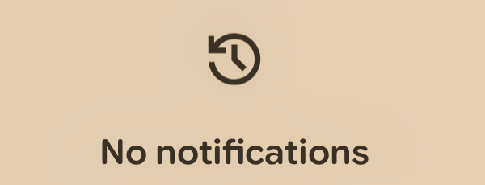

# I Don't Want To Catch Up

**Android 17 replaced "No notifications" with a trophy. This gives the trophy back.**



<details><summary>Wanna see the trophy? Take it! 🏆</summary>
  <table>
    <tr>
      <th></th>
      <th></th>
    </tr>
    <tr>
      <td>Do you like it?</td>
      <td>let's send it back.</td>
    </tr>
  </table>
</details>

## The pitch

Somewhere in Mountain View, someone looked at an empty notification shade — the calmest screen a
phone can show a human being — and decided it needed a participation trophy.

Android 17 shipped exactly that. The plain, honest `No notifications` line was replaced by a gold cup
and the words *"You're all caught up!"*, ported over from the Pixel Watch. Google's own write-up
calls it "a fun little way to say you've finished notifications."

Finished. Notifications. Like a level. Like something you were supposed to clear before somebody
else needed something from you.

An empty shade is not an achievement. It is the absence of pending work. Turning it into a scoreboard
is how you get people to keep checking the scoreboard — and a scoreboard is only interesting if you
can fall behind on it. The trophy is not a reward for finishing. It is a reminder that the queue
refills, and that next time you might not be caught up at all.

This module declines the trophy. It also does one small honest thing: the icon it puts there is the
icon of the notification history button, because tapping that area is what actually opens
notification history. The picture finally matches the button.

\* You can still click the icon to view the notification history.


## Requirements

- Android 17 — that is where the trophy exists
- Root, with Magisk — the overlay has to be preinstalled, see [Notes](#notes)
- `adb` for the install below, or just use the Magisk app

## Install

Download, install in Magisk / Apatch / KernelSU or anything else.

or:

```sh
adb push build/i-dont-want-to-catch-up.zip /data/local/tmp/
adb shell su -c 'magisk --install-module /data/local/tmp/i-dont-want-to-catch-up.zip'
adb reboot
```

## What it changes

One static RRO for `com.android.systemui`. Two resources, no code, no services, nothing running in
the background:

| Target resource | Becomes |
| --- | --- |
| `string/caught_up_shade_text` | `No notifications` |
| `drawable/ic_trophy` | the notification history icon |

The icon is **copied into this repo**, not referenced from SystemUI, so a future SystemUI refactor
that moves or renames its own drawables cannot break this. Colour is left entirely to SystemUI: the
drawable is a plain monochrome vector, and the shade's own `ImageView` tints it with
`color/materialColorOnSurface` (which has a `(night)` variant) while `setContentColor()` re-applies
the framework's `materialColorOnSurface`. Light, dark and wallpaper-based dynamic colour all follow
along for free.


Then confirm it landed:

```sh
adb shell cmd overlay list com.android.systemui
# [x] io.github.leohearts.idontwanttocatchup

adb shell cmd overlay lookup com.android.systemui com.android.systemui:string/caught_up_shade_text
# No notifications
```

## Build

```sh
./build.sh
```

Uses `ANDROID_HOME` (fallback `~/Android/Sdk`) for `aapt2`, `zipalign` and `apksigner`, and signs
with `~/.android/debug.keystore`. Override with `KS`, `KS_PASS`, `KEY_ALIAS`, `KEY_PASS`. Output:
`build/IdontWantToCatchUp.apk` and the flashable `build/i-dont-want-to-catch-up.zip`.

## Customise

- **Want the shade to say nothing at all?** Empty the string in
  [`overlay/res/values/strings.xml`](overlay/res/values/strings.xml).
- **Want a different icon?** Drop your own vector at `overlay/res/drawable/ic_trophy.xml`. Keep it
  monochrome, and keep at least one `<path>` in it — see Notes.
- **Want the iconless pre-17 look instead?** Override `dimen/empty_shade_icon_size` and
  `dimen/empty_shade_icon_bottom_margin` to `0dp` rather than overriding the drawable.

## Uninstall

In your superuser app.

or:

```sh
adb shell su -c 'rm -rf /data/adb/modules/i-dont-want-to-catch-up'
adb reboot
```
## Credits

- Icon path data: AOSP SystemUI `packages/SystemUI/res/drawable/notif_footer_btn_history.xml`
  (Apache-2.0).
- The trophy being removed belongs to whoever decided you needed one.

## License

Apache-2.0 — see [LICENSE](LICENSE).
